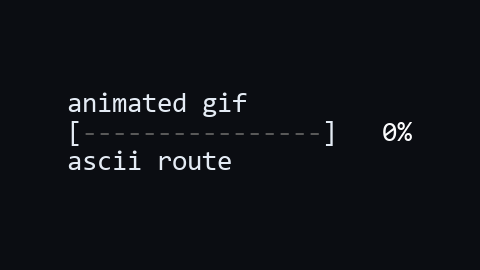
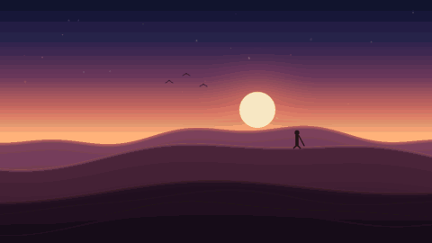
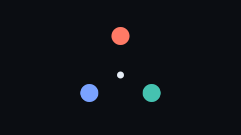

# Animated GIF

An agent skill that turns ASCII frames, a folder of images, or an SVG or HTML animation into a single GIF. One shared core handles the palette, timing, frame merging, scaling and verification, so every route produces the same predictable format. No service, no upload, output stays in the project.

## Samples

Click a sample to open the full-size GIF.

| ASCII | Image folder | SVG |
|:---:|:---:|:---:|
| [](docs/demo-ascii.gif) | [](docs/demo-pics.gif) | [](docs/demo-svg.gif) |
| Colored text frames | Holds, crossfade, Ken Burns | SMIL, CSS or a preset |

Samples are generated by `python tools/make_docs.py`.

## Routes

| Input | Tool | Motion |
|---|---|---|
| Text frames with ANSI colors | `agent-skill/bin/ascii_gif.py` | frame sequence |
| Folder of photos or images | `agent-skill/bin/pics_gif.py` | holds, crossfade, Ken Burns |
| SVG or HTML animation | `agent-skill/bin/svg_gif.py` | SMIL, CSS, or preset rotate/pulse/fade |
| Any RGB frame sequence | `agent-skill/bin/gifkit.py` | custom generator |

## Requirements

Pillow is required. The SVG route also needs Node with Playwright and a Chromium based browser; an installed browser is used when one is found, and the Playwright download is only the fallback.

```sh
python -m pip install --user pillow
python -c "import PIL; print(PIL.__version__)"
```

| Tool | Windows | Debian/Ubuntu | macOS |
|---|---|---|---|
| Node | `winget install OpenJS.NodeJS.LTS` | `sudo apt install nodejs npm` | `brew install node` |

```sh
npm install -g playwright
node -e "require('playwright')"
```

`npx playwright install chromium --only-shell` is only needed when no Chromium based browser is installed. `GIFKIT_BROWSER` or `--browser PATH` names one explicitly; otherwise Chromium, Google Chrome and Edge are searched in their usual install locations.

The tools are written for Windows, Linux and macOS: no drive letters, no hardcoded home folders, font discovery through the OS font folder, and `shutil.which` for node. Commands in this README use forward slashes, which work in PowerShell and POSIX shells.

## Install

The skill payload is in `agent-skill/`. Clone the repository, then copy that folder into the skills folder for your agent and name the copy `animated-gif`. The folder name must match the `name` in `SKILL.md`.

```sh
git clone https://github.com/chezhenkie/animated-gif-skill.git
```

| Agent | All projects | One project |
|---|---|---|
| OpenCode | `~/.config/opencode/skills` | `.opencode/skills` |
| Codex | `~/.agents/skills` | `.agents/skills` |
| Pi | `~/.pi/agent/skills` | `.pi/skills` |
| OMP | `~/.omp/agent/skills` | `.omp/skills` |

Copy `animated-gif-skill/agent-skill` to the path from the table as `animated-gif`. `~` is your home directory; if your shell does not expand it, use the full path. For example:

```powershell
Copy-Item -Recurse animated-gif-skill/agent-skill "$HOME/.config/opencode/skills/animated-gif"
```

```sh
cp -r animated-gif-skill/agent-skill ~/.config/opencode/skills/animated-gif
```

Codex scans `.agents/skills` from the current folder up to the repository root. Pi and OMP scan one level under `skills/`. Restart the agent if the skill does not appear.

## Use

Ask for the GIF and name the input. The agent picks the route, runs one tool, reads the printed summary and reports the verified path.

| Agent | Invocation |
|---|---|
| OpenCode | `@animated-gif` |
| Codex | `$animated-gif` |
| Pi | `/skill:animated-gif` |
| OMP | `/skill:animated-gif` |

Codex also lists installed skills with `/skills`.

Example requests:

```text
Make a loading GIF from frames.txt with the ASCII tool, 120 ms per frame.
Turn photos/reel/ into an 800 px crossfade GIF at 12 fps.
Animate logo.svg with the rotate preset, 3 seconds, 15 fps.
```

Direct CLI use, from the repository root:

```sh
python agent-skill/bin/ascii_gif.py frames.txt -o project/loader.gif --size 28 --delay 120
python agent-skill/bin/pics_gif.py photos/ -o project/reel.gif --mode kenburns --fps 12 --hold 1.2 --width 800
python agent-skill/bin/svg_gif.py logo.svg -o project/logo.gif --animate rotate --duration 3 --fps 15
```

Each tool prints `<name>  N frames, X.XX s, W x H` after writing and verifying the GIF. A failure prints one `FAIL` line on stderr, exits 1 and leaves no partial output.

## Files

| File | Purpose |
|---|---|
| `agent-skill/SKILL.md` | Agent entry point, workflow, route options and contract |
| `agent-skill/bin/gifkit.py` | Palette, timing, frame merge, atomic write, verification |
| `agent-skill/bin/ascii_gif.py` | ANSI text frames to GIF |
| `agent-skill/bin/pics_gif.py` | Image folder to GIF |
| `agent-skill/bin/svg_gif.py` | SVG/HTML animation to GIF |
| `agent-skill/bin/render_frames.cjs` | Playwright frame capture helper |
| `agent-skill/references/animated-gif-considerations.md` | Format constraints and defaults |
| `tools/check.py` | Route checks and repository hygiene |
| `tools/make_docs.py` | Regenerates the sample GIFs |
| `docs/` | Samples, human index and the specsheet |
| `docs/specsheet/` | Binding specification, starting at `00-overview.md` |
| `docs/research/` | Research notes and measurements, not binding |
| `CHANGELOG.md` | Version history |

## Check

Run from the repository root:

```sh
python tools/check.py
```

The script generates fixtures, runs each route, verifies frame count, duration, size and motion, and scans the repository text for secrets, absolute paths, non-ASCII characters and CRLF endings. Missing optional dependencies produce `SKIP` lines instead of failures; add `--strict` to require every route:

```sh
python tools/check.py --strict
```

## Limits

- GIF is 8-bit indexed and caps at 256 colors. Photos band; use `--dither floyd` or choose APNG or WebM for truecolor work.
- Viewers clamp short delays. The tools keep delays at 20 ms or more.
- Frame count and canvas size drive memory; the tools hold all frames while building one palette.
- SVG and HTML capture covers CSS and SMIL animation. JS-driven canvas or WebGL pages need their own frame hook or pre-rendered frames.
- ASCII glyph coverage depends on the font. Missing block or box glyphs render as empty boxes.

## License

MIT
