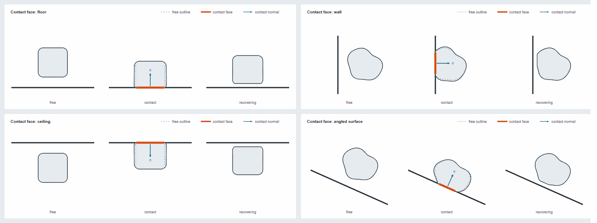

# Kinetic motion

Mandatory before choosing fps, delay, easing or a preset, and before any contact, spring, chain, surface or deformation decision. Motion that reads as physical comes from spacing, contact and weight, not from a curve name. Numbers assume 480x270 at 25 fps; at 12 fps hold the milliseconds and halve the frame counts, because one frame there is 80 or 90 ms. What the timeline cannot express is listed under Not implemented yet.

## Timing

Read this section before setting or changing fps, delay, hold, transition, duration, frame count or loop mode, and before compressing a move to 12 fps.

1. Give every move a frame count as well as a duration. At 25 fps a frame is 40 ms; at 12 fps the delay runs 80, 90, 80 in each 250 ms, so a 40 ms band is under one frame.
2. Spacing is timing: in a rest-to-rest move the first and last gap between frames is at most 30 percent of the largest gap. A 100 px move over 10 frames has a middle gap near 20 px and end gaps of 1 to 3 px. Apply the test once to the whole move, not to each bounce or settle. A move that starts or ends at speed, such as an exit or a camera pan, is not bound at that end; judge it at the seam instead.

## Contact and weight

Read this section before placing a landing, impact, bounce, drop, slide or any held contact, and before a 12 fps plan with contacts. Look at contact-face.png before choosing the contact face on any shape.

3. Every contact is a held frame of max(40 ms, one frame): one frame at 25 fps, two for a heavy object, one frame of 80 or 90 ms at 12 fps. Put the contact on a frame time, because the plan has no contact-time hook between samples. A contact of zero frames reads as a bounce off nothing.
4. Bounce heights fall by restitution squared and the intervals by restitution, so the decay is geometric, never linear. A physical ball reads at a height ratio of 0.35 to 0.55, which is restitution 0.59 to 0.74; the cartoon default of 0.5 gives 0.25. A GIF rarely has room, so cut to two bounces and a settle.
5. The last pixels sell the weight: the settle is the final 2 to 3 px over 2 to 3 frames, at 0.5 to 1 px per frame. Stop a spring at 0.5 px or 2 px/s, and never let it cross the loop point. A settle is capped at 1.5 times its segment rather than refused, so in cycle mode a spring must reach rest before the segment ends.
6. Squash preserves area: width = 1 / height, contact squash 15 to 25 percent, stretch at speed 15 to 30 percent. The compressed face is the contact face: the bottom on a floor, the side on a wall, the top on a ceiling. The parser refuses `squash` and `stretch`, so draw the deformation into the art or bake the frames.
7. Weight is carried by the edges, not the middle. Heavy means 6 to 10 frames (240 to 400 ms) of anticipation against 2 to 3 (80 to 120 ms), a contact of 2 to 4 frames (80 to 160 ms) against 1, 0 or 1 bounces against 3 to 5, and 2 percent overshoot against 8 to 12. Gravity is the same for all masses; a heavy object does not fall faster.

The figure shows a floor, a wall, a ceiling and an angled surface, each as free, contact and recovering. The orange line is the contact face, flat along the contact normal; the teal arrow is that normal; the dashed outline is the free shape. The body bulges away from the surface so the area is kept, which is why the sides of a squashed ball bow out. The rule follows the surface, not the shape: a rounded square, an irregular blob or a ball flattens the face that meets the surface and recovers in place. A bounce is a run of these contacts, each one flattening the face and restoring it before the next, and a pose-swap deformation starts with the face already flat.

## Curves

Read this section before any overshoot, arc, spring-versus-bezier choice, spring damping, frequency or settle, or bezier handle, and before claiming the 6 px cap.

8. Overshoot is measured from the evaluated curve, not written into a control point: with the second handle at 1, y1 1.05 gives 0.04 percent and y1 1.4 gives about 5.3 percent. The 6 px cap is not implemented; it applies to every property at the furthest point of the element, so keep travel small.
9. Springs are for reactions (landing, settle, follow-through, interruption); beziers are for choreography (entrance, exit, camera, loop). A spring retargets a value, a bezier hits a mark. Damping 0.4 to 0.55 is playful, 0.6 to 0.75 confident, 0.8 to 0.95 crisp, 1.0 and above never overshoots. Frequency 8 to 12 rad/s is heavy, 15 to 25 normal, 30 to 40 snappy. An arc with bend 0.1 bows a 100 px move by 5 px. One gravity per scene: 1400 px/s^2 for a cartoon read, 981 for a plausible one.

## Chains and finish

Read this section before a copied track, echo, follow-through or opacity stagger, and before expecting a `gain` or delay field.

10. Follow-through is a delay: one to two frames per link (40 to 80 ms) at 25 fps, and fewer links at 12 fps rather than longer delays. A copied track has no spring, a `gain` field does not exist, and a copy clamps at the source end, so in cycle mode it must wrap modulo the duration.
11. Keep positions sub-pixel through the move and snap only at render. Snapping every frame turns a 0.4 px move into 1 px jumps.
12. Nothing may still be moving at the loop seam. Position and velocity must match across it: a spring or chain must be at rest, while a linear or bezier camera may carry constant velocity. A camera that pans across a repeating drawing may jump one tile at the seam, because the pixels then match; without tiling it must return to its start. A rest is the settled, supported pose at the end of a move: the body has stopped on a surface, its contact face is flat along the normal, and the last sample already shows that pose. It is the only hold longer than one contact frame. Keep it for at least 3 frame times, 120 ms at 25 fps and 250 ms at 12, through the seam; one frame, even doubled at the seam to 80 ms, reads as a pause. An apex, a turning point or any pose mid-flight is not a rest, even where velocity is zero for an instant: every frame there must be a new pose, and a ball that hangs at the top of a bounce is a defect. A contact inside a bounce is one held frame of max(40 ms, one frame) on the surface and never becomes a rest.

## Defaults

Read this section before overriding a row, or whenever the scene is an entrance, exit, drop, bounce, slide, shake, pulse or camera.

Frames are at 25 fps; at 12 fps hold the durations and halve the frame counts.

| case | travel | duration | motion | status |
|---|---|---|---|---|
| entrance | 4 to 60 px | 240 to 320 ms | bezier (0, 0, 0.2, 1), then a 2 to 4 percent overshoot key | ok; one link, 40 ms |
| exit | 4 to 60 px | 120 to 200 ms | bezier (0.4, 0, 1, 1) | ok |
| drop | 40 to 200 px | 240 to 540 ms | keyed fall or ballistic scalar, g 1400, cartoon e 0.5, two bounces | ok; squash is refused |
| bounce | 8 to 40 px | 320 to 400 ms | spring, k 400, c 30 | ok; one link, 40 ms |
| slide | 40 to 200 px | T = sqrt(2d/(mu g)), 340 to 760 ms | cubic-bezier(0.333, 0.667, 0.667, 1), v0 = 2d/T | ease only; friction is refused |
| shake | 2 to 4 px | 120 to 200 ms | spring layer, 4 to 6 cycles, decay 0.5 | ok |
| pulse | scale 1.00 to 1.05 | 320 to 400 ms | bezier (0.4, 0, 0.2, 1) | ok |
| camera | 100 to 480 px | 800 to 1600 ms | linear or (0.4, 0, 0.2, 1) | ok; parallax 2 to 6 px |

The route refuses ballistic motion on a transform, so a fall is keyed there. A fall time of sqrt(2h/g) usually lands between frames: 100 px at g 1400 is 378 ms, so key 400 ms and 112 px, or choose g to fit the frame.

A slide is constant deceleration at mu 0.5 and g 1400: 100 px needs 374 px/s over 535 ms, and the last 20 percent of the distance takes 45 percent of the time. Round T to a whole frame: 535 ms at 12 fps becomes 580 ms, and the last sample can sit a fraction short of the distance.

## Not implemented yet

Read this section before using or requesting friction, squash, stretch, smear, gain, mesh, particles, spatial masks, path keys or raster keys.

- `friction`, `squash`, `stretch`: refused on a ballistic key.
- `smear`, `gain`, a chain binding delay and a contact time between frames: no field exists. A 6 px overshoot cap: not implemented.
- Path morphs, raster keys, ASCII grids, spatial masks: refused on the tween route.
- Particles, per-vertex meshes, simulation: not implemented.

## Surfaces

Read this section before sand, water, a pour, pile, avalanche, splash, wave, droplets, rings or staggered copies.

Sand and water are bulk shapes, not particles: at 100 px/m a grain is 0.01 to 0.05 px and a droplet 0.2 to 0.5 px, so draw the silhouette and texture it.

- Sand: a pour is a 2 to 4 px ribbon tapering 20 to 40 percent, with 24 to 40 dots of 1, 1.5 and 2 px at 60/30/10. A pile is a triangle, 2:3 rise to run (base three times the height) when dry, 1:1 damp, 1:2 saturated, and its height grows as sqrt(t). An avalanche starts 2 to 3 degrees above repose, moves the face 2 to 4 px over 2 to 3 frames, then holds the new slope. A pour is monotone, so play it once or start from a seeded pile; it cannot loop by itself.
- Water: a splash runs crown, jet, droplets, rings. The crown is one held pose at 25 fps and cannot exist at 12; the jet is held 1 to 2 frames; 5 to 20 droplets leave staggered 1 to 2 frames; two or three 1 px rings fade as r^-0.5. A wave band is three or four strips with staggered phase, not one sine.
- Copies: two or three extra copies at 40 to 60 percent opacity, with the main element at full, spaced by the per-frame travel, or one copy at 12 fps. Stagger them 40, 80 or 120 ms at 25 fps and 80, 170 or 250 ms at 12. The timeline has no copy field, so each copy is its own track and element.
- Palette: material colours must be exact entries; dither only areas over 4 px; the palette keeps at most 12 samples, so include a 1 to 2 frame crown or dent in the picks. APNG when colour matters.

## Deformation

Read this section before a dent, net, cloth, flag, jelly, pose swap, or a fast small object that reads as a streak.

Fast deformation is a pose swap: a 25 to 40 px net dent completes in 1.4 to 3 frames at 25 fps and rebounds once, so three to five drawn poses on opacity holds read as a simulation, the first already at full depth and already showing the flat contact face from contact-face.png; the approach is not drawn. A 7.5 px ball at 40 m/s moves 160 px per frame and never reads as a dot: start near contact and draw a streak.

Slow deformation (flag, cloth, jelly) needs a mesh: one track of vertex offsets, projective cells about 16 by 10 for 0.5 to 1 px of error, matrix3d on clipped cell copies. A part that meets a surface uses the face in contact-face.png as a boundary: the vertices on the surface stay flat along the normal while the rest of the body deforms. The timeline has no mesh kind and refuses path kinds, so draw poses or render frames instead, and treat any mesh export as baked.

## Before delivering

Run this checklist before reporting, alongside the format validation checklist in animated-gif-considerations.md.

- Every move has a frame count, and the ends of a rest-to-rest move are slower than the middle.
- Every contact exists as a held frame on a frame time, at least max(40 ms, one frame); it is not a rest.
- No two flight frames are identical: an apex turns, never pauses, and no bounce starts or ends with a hold.
- Every contact face is flat along the contact normal, and a bounce restores it between contacts.
- Bounce heights decay, and the last bounce is small enough to read as a stop.
- Overshoot stays within 6 px of travel, measured at the furthest point; today keep the travel small.
- Copies are staggered by at least one frame, and the loop divides by copies times stagger.
- Nothing is still moving at the loop point; the only rest is the settled supported pose at the seam, it holds 3 frames or more, and a seam hold counts twice.
- The frame budget holds: 2 s at 25 fps is 50 sampled frames before merging; the stored count is lower.

Full specification: docs/specsheet/10-kinetic-motion.md in the source repository.
