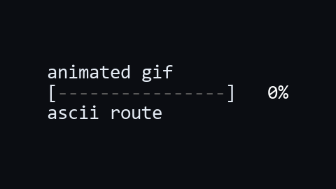
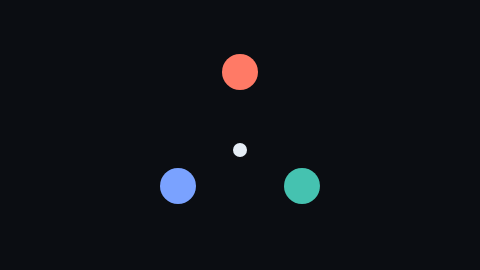
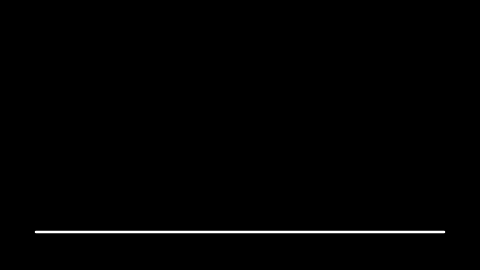
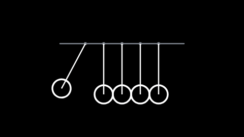
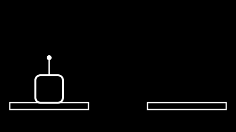
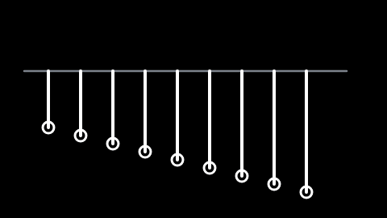

# Documentation

An animation maker with a keyframe engine at its centre: text frames, image folders, live SVG or HTML pages, and JSON timelines all run through the same pipeline, and a GIF or APNG can be read back into frames and a timing manifest. This folder holds three kinds of document, and they are kept apart on purpose.

- [specsheet/](specsheet/00-overview.md) is binding. It states what the system does and what the Rust port must satisfy. Start with the overview, which holds the table of contents and the design rules.
- `research/` is evidence. Measurements, sources and prior art sit there, and a specsheet wins wherever the two disagree.
- This page and the [README](../README.md) are for humans. They are shorter and meant to be read once.

## Samples

| text frames | image folder | SVG animation | keyframes |
|---|---|---|---|
|  |  |  |  |

The image sample is one dune ridge at three times of day, the SVG sample is an authored pulse monitor, and the keyframe sample is an orrery on a JSON timeline. The keyframe sample is also written as [APNG](demo-tween.apng) and as an [animated SVG](demo-tween.svg); the SVG plays in a browser without a script.

## Kinetic studies

| Gravity | Momentum |
|:---:|:---:|
|  |  |
| Ballistic | Follow-through |
|  |  |

The four are white line work on black, generated with the other samples by `tools/make_docs.py`.

## Reading order

1. [Specsheet overview](specsheet/00-overview.md): the rules, and the list of parts.
2. [Behaviour baseline](specsheet/01-behaviour-baseline.md): what the frozen Python did, and what the binary reproduces.
3. [Crate split](specsheet/02-crate-split.md) and [frame flow](specsheet/03-frame-flow.md): how the Rust workspace is shaped.
4. Parts 04 to 07: the tween crate, from time and keys to layers.
5. [Tween route](specsheet/11-tween-route.md): how a JSON timeline becomes the fourth route.
6. [Output formats](specsheet/12-output-formats.md): GIF, APNG and the SVG export.
7. [Extract and rebuild](specsheet/13-extract-and-rebuild.md): frames and timing back out, and the manifest that rebuilds them.
8. [Import](specsheet/14-import.md): an animated SVG sampled back into the timeline.
9. [Kinetic motion](specsheet/10-kinetic-motion.md): what makes a move read as physical, from contact and weight to sand, water and deformation.
10. [Decisions](specsheet/09-decisions.md): what is settled and what is still open.

## Research notes

| note | subject |
|---|---|
| [tween-math-easing](research/tween-math-easing.md) | bezier solvers, springs, splines, precision |
| [tween-timeline-model](research/tween-timeline-model.md) | easing ownership, duplicates, loop modes, one model for several formats |
| [tween-performance-memory](research/tween-performance-memory.md) | streaming against a palette pass, stage costs, memory, benchmarks |
| [tween-property-types](research/tween-property-types.md) | paths, raster, ASCII grids, prepare against sample |
| [tween-composition](research/tween-composition.md) | layers, weights, composite operations |
| [kinetic-motion](research/kinetic-motion.md) | craft rules, gravity and weight, bounce decay, springs, defaults |
| [keyframe-tween-animation-info](research/keyframe-tween-animation-info.md) | methods table and schema sketch that started the tween work |
| [multi-conversion-formats-info](research/multi-conversion-formats-info.md) | format matrix and the conversion directions that follow the port |
| [python-to-rust-refactor-pitfalls](research/python-to-rust-refactor-pitfalls.md) | porting pitfalls and the merge checklist |

## Checks

The gate is the Rust test suite in `rust/`: `cargo test --workspace`, clippy and fmt, run on Linux and Windows in CI. The gate is specified in [08-fixtures-and-gate](specsheet/08-fixtures-and-gate.md).

The crate dependencies are drawn in [ascii-crate-flow.txt](ascii-crate-flow.txt).
